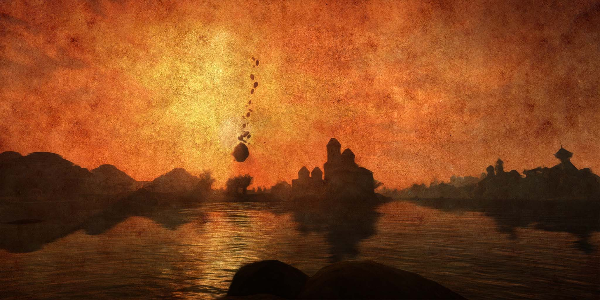

UI Remastered is a Morrowind texture mod that aims to replace every element of Morrowind's user interface with improved, modern design. UI Remastered replaces, cursors, buttons, UI & HUD Design, stat bars, item & magic icons, crosshairs, book & scroll textures, and splash screens.

- [Installation](#installation)
- [Packages](#packages)
  - [00 - Cursors](#00---cursors)
  - [01 - Main Menu Buttons](#01---main-menu-buttons)
  - [02 - Book & Scroll Buttons](#02---book--scroll-buttons)
  - [03 - UI & HUD Elements](#03---ui--hud-elements)
  - [04 - Stat Bars](#04---stat-bars)
  - [05 - Item Icon Frames](#05---item-icon-frames)
  - [06 - Crosshairs](#06---crosshairs)
  - [07 - Skill & Magic Icons](#07---skill--magic-icons)
  - [08 - Item Icons](#08---item-icons)
  - [09 - Splash Screens](#09---splash-screens)
  - [10 - Book & Scroll Textures](#10---book--scroll-textures)
  - [11 - Alt Cursor](#11---alt-cursor)
  - [12 - OpenMW Compatibility](#12---openmw-compatibility)
  - [Silver Edition](#silver-edition)
- [Examples](#examples)
  - [Cursors](#cursors)
  - [Book & Scroll Texture](#book--scroll-texture)
  - [Menu Buttons](#menu-buttons)
  - [Icon & Menu Design](#icon--menu-design)
  - [Splash Screens](#splash-screens)
  - [Silver Edition](#silver-edition-1)
- [Uninstallation](#uninstallation)

## Installation

To install UI Remastered, you will first need to download it. You can get the latest version from [Nexus Mods](https://www.nexusmods.com/morrowind/mods/48987).

The best way to install UI Remastered is through a mod manager, such as [Mod Organizer 2](https://www.nexusmods.com/skyrimspecialedition/mods/6194). It comes with a full FOMOD installer that allows you to pick and choose which parts of UI Remastered that you wish to install.

If installing manually, unpack the downloaded file. Each folder inside is a separate module which can be installed independently. To install, simply extract the contents of each module into the `Data Files` directory in your Morrowind game folder.

## Packages

### 00 - Cursors

This first pack is a replacement for the cursors in Morrowind. I really liked the style of the cursors in Morrowind UI Revamped and so these cursors share the rough shape of those icons, although with only a light bevel to keep them clean.

### 01 - Main Menu Buttons

This pack replaces the buttons on the main menu and the in-game escape menu. I've gone for clean text with a slight bevel to give it a bit of depth.

Has support for the following main menu additions:

- [Continue](https://www.nexusmods.com/morrowind/mods/45952) adds a 'Continue' button to load your last save.
- [Morrowind Script Extender](https://github.com/MWSE/MWSE/) adds a 'Mod Config' option to manage mwse mods.

### 02 - Book & Scroll Buttons

I really liked what [UI Revamped](https://www.nexusmods.com/morrowind/mods/43922) was trying to do with using icons in place of text for some of the journal buttons, so I've taken this to the next step and replaced almost every book and scroll button with an icon-based button.

### 03 - UI & HUD Elements

This pack is mostly just bordering for buttons and UI windows. I've removed the thicker borders and given the thinner borders a cleaner look. I've also altered the header bar and turned it into two thinner bars for a bit of a simpler design. I've also redesigned the scroll bar to make it match the new design a bit better.

The HUD Elements contain support for [MGE XE - HUD Mods](https://www.nexusmods.com/morrowind/mods/41102) Time display mod, replacing the letters and numbers used.

### 04 - Stat Bars

This just replaces the Health, Magic and Fatigue bars with new ones using less of a gradient.

### 05 - Item Icon Frames

This replaces the background for enchanted weapons and introduces cleaner versions of the borders sused for equipped items and during bartering.

### 06 - Crosshairs

There are two crosshair options.

The **Morrowind crosshairs** are a slightly smaller version of the vanilla crosshair and an ownership icon that pairs with it nicely and is less intrusive than the red hand icon commonly used.

The **Skywind crosshairs** is the crosshair made by Left4No, along with a modified version to use as an ownership icon.

If you want the ownership indicator to work, you'll either want;

- [MGE XE - HUD Mods](https://www.nexusmods.com/morrowind/mods/41102) from optional files, you'll only need the ownership indicator plugin.
- [Ownership Indicator](https://www.nexusmods.com/morrowind/mods/45940) if you want a plugin-free version.

### 07 - Skill & Magic Icons

I've made three packs of replacers for skill and magic icons. This also includes replacers for the filter icons in UI Expansion.

The **Smooth pack** is close to vanilla, but without the rough, brick-like texture of the icon, replacing it with a smoother, almost painted look.

The **Borderless pack** is the actual symbol from the icon, coloured in and with a black background, which looks much cleaner and more modern than the vanilla icons. It also makes it easier to learn and recognise icons on the fly compared to vanilla, where all icons look just like little coloured squares.

The **Borderless Transparent pack** is the same as the borderless one, but with the black background being transparent instead. It looks better if you have menu transparency on, but can look a little strange in places.

Both packs support the following mods:

- [Magicka Expanded](https://www.nexusmods.com/morrowind/mods/47111) adds various new spells.
- [UI Expansion](https://www.nexusmods.com/morrowind/mods/46071) adds filters to the menu with their own icons.

### 08 - Item Icons

I've made two packs of replacers for item icons, both are based on the Ultimate Icon Replacer pack. They also include a new gold icon that I made using a photo of the coin from the Oblivion Collector's Edition.

The **Crisp pack** is a slightly sharper and more 3D looking versions of the icons, I tried to make them look more like small items as opposed to icons for them here. They look the best with the new Item Icon Frames.

The **Material pack** is a flattened version of the icons, looking similar to Material UI Design icons. They aren't as easy to distinugish as the regular icons, but provide a slightly more modern web design feeling.

Both packs support [Tamriel Data](https://www.nexusmods.com/morrowind/mods/44537) and any of the mods that use it as a base.

### 09 - Splash Screens

A small pack of splash screens using screenshots from my game with some visual effects.

### 10 - Book & Scroll Textures

A replacement for the book and scroll background textures as well as the journal bookmark.

### 11 - Alt Cursor

An optional replacement for the main cursor for those who don't like the current one. You'll still need the original pack for the other cursors.

### 12 - OpenMW Compatibility

If using the UI & HUD Elements module from this mod and you plan on using OpenMW, you should install this pack as well. Do not install this if you are not using OpenMW.

### Silver Edition

UI Remastered features an alternative 'Silver Edition'. If installing this edition, use the alternative Silver Edition modules where appropriate. You will also need to make the following changes to Morrowind.ini to alter the font colours, these changes are the same as for [Skyrim UI Overhaul](https://www.nexusmods.com/morrowind/mods/43039):

```ini
[FontColor]
color_normal=150,150,150
color_normal_over=200,200,200
color_normal_pressed=255,255,255

color_active=255,255,255
color_active_over= 150, 150,150
color_active_pressed=255,255,255

color_disabled=100,100,100
color_disabled_over=140,140,140
color_disabled_pressed=100,100,100

color_link=58,78,181
color_link_over=91,112,222
color_link_pressed=97,106,156

color_journal_link=37,49,112
color_journal_link_over=58,77,175
color_journal_link_pressed=112,126,207

color_journal_topic=0,0,0
color_journal_topic_over=58,77,175
color_journal_topic_pressed=112,126,207

color_answer= 181, 58,58
color_answer_over=230,80,80
color_answer_pressed=155,80,80

color_header=255,255,255
color_notify=100,100,100

color_big_normal=200,200,200
color_big_normal_over=255,255,255
color_big_normal_pressed=150,150,150

color_big_link=255,255,255
color_big_link_over=255,255,255
color_big_link_pressed=150,150,150

color_big_answer= 200,200,200
color_big_answer_over=255,255,255
color_big_answer_pressed=150,150,150

color_big_header=200,200,200
color_big_notify=200,200,200

color_background=0,0,0
color_focus=80,80,80

color_health=200,60,30
color_magic=53,69,159
color_fatigue=0,150,60

color_misc=0,205,205

color_weapon_fill=200,60,30
color_magic_fill=200,60,30

color_positive=35,219,109
color_negative=200,60,30

color_count=255,255,255
```

## Examples

### Cursors


*Morrowind's default cursors.*

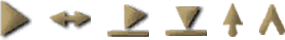

*UI Remastered cursors.*

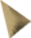

*Alternative main cursor.*

### Book & Scroll Texture

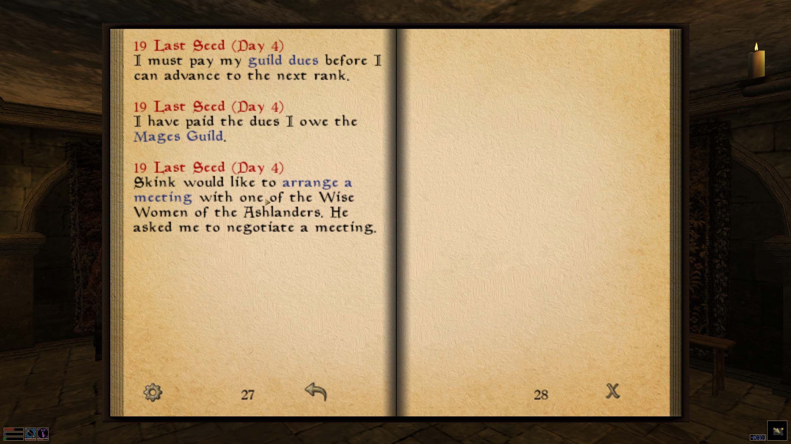

*New book texture.*

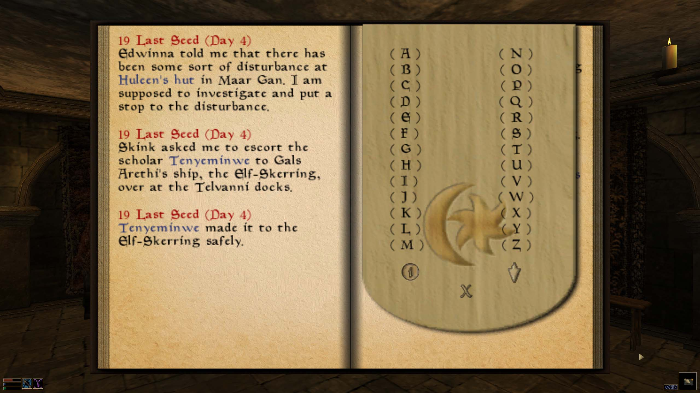

*New bookmark texture.*

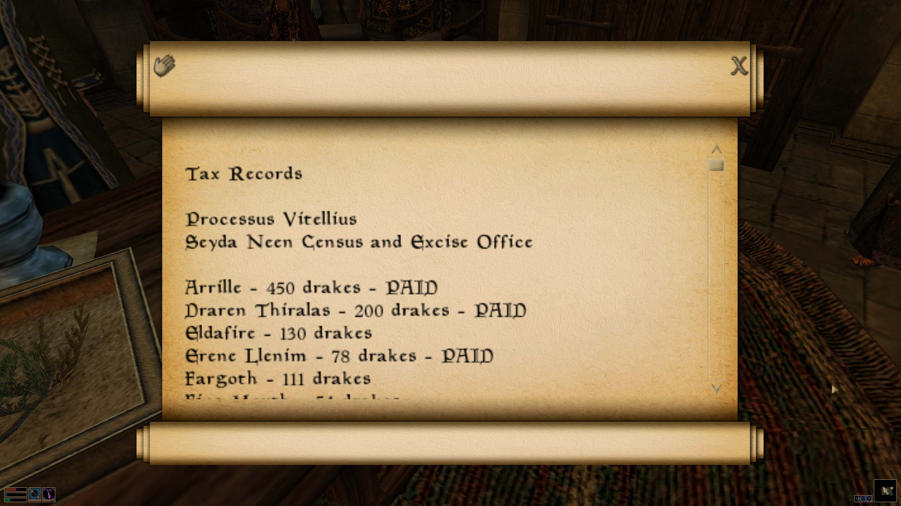

*New scroll texture.*

### Menu Buttons

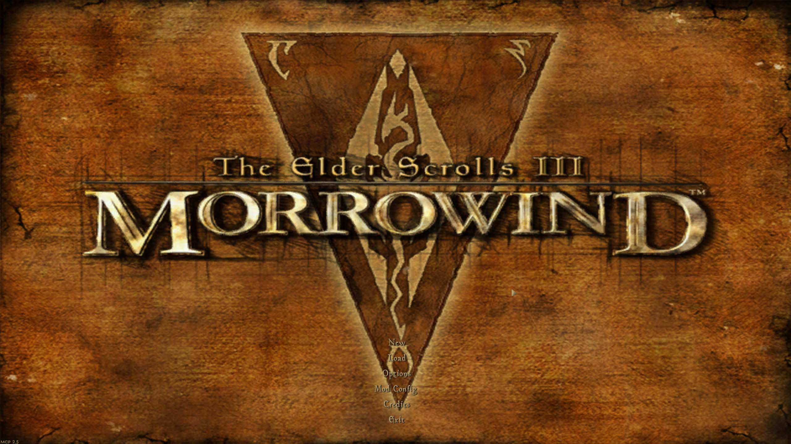

*New main menu buttons.*

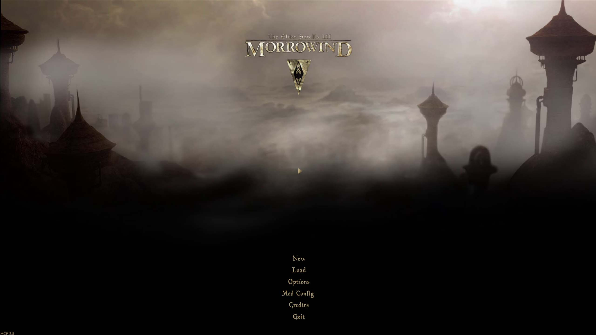

*New main menu buttons with the Animated Main Menu mod.*

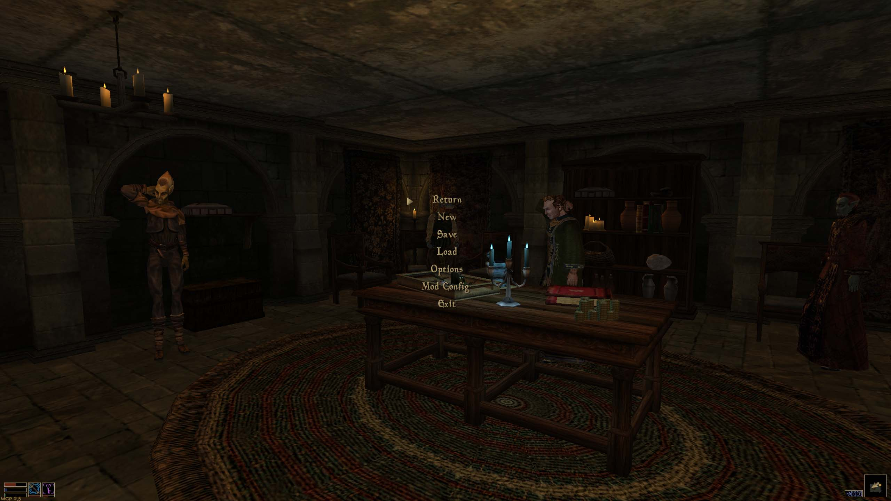

*Escape menu buttons.*

### Icon & Menu Design

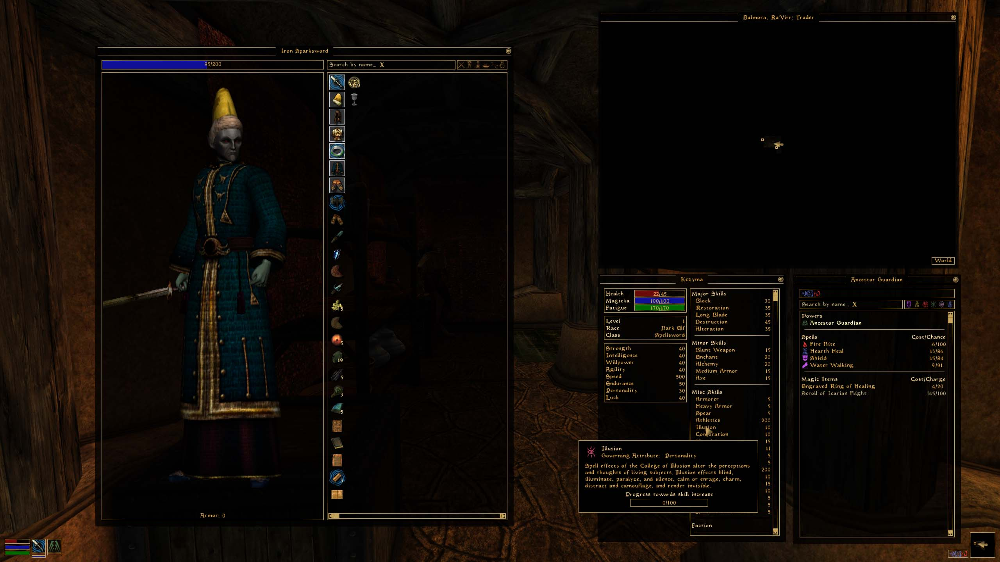

*Crisp item icons, borderless magic icons.*

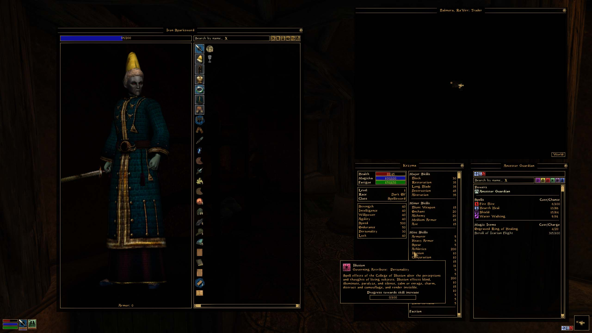

*Flat item icons, smooth magic icons.*

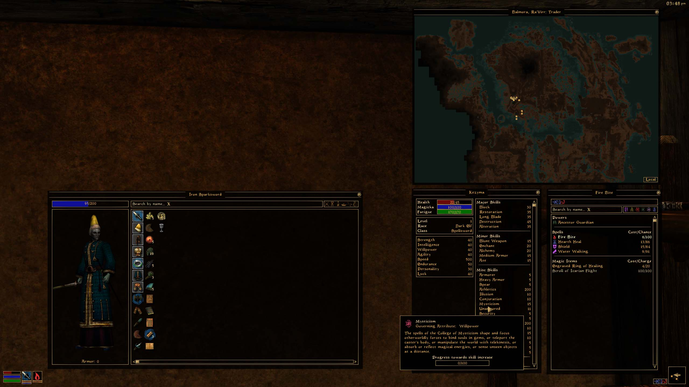

*Menu with remastered scrollbar.*

### Splash Screens

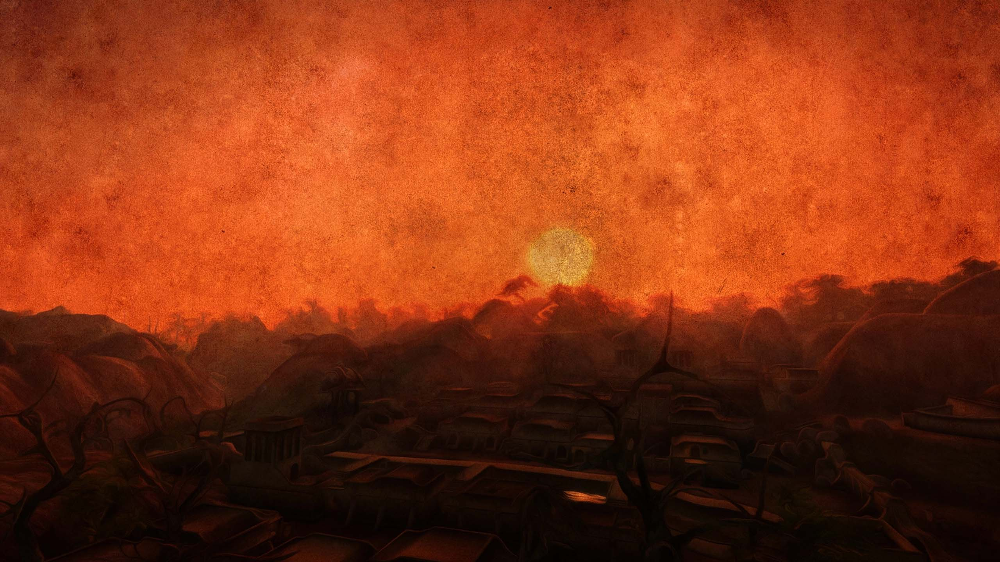

*A splash screen of Balmora.*

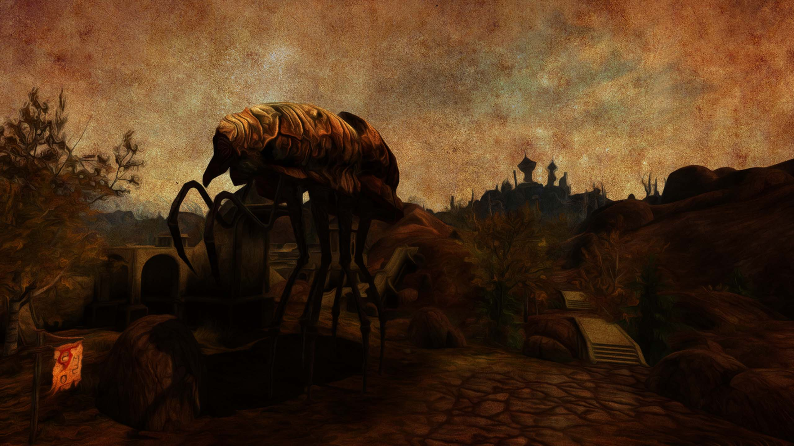

*A splash screen of a Silt Strider.*

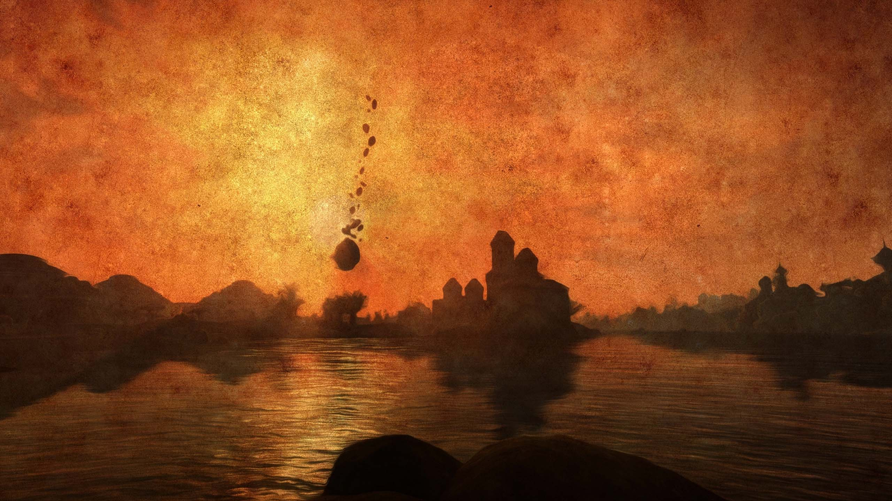

*A splash screen of Vivec.*

### Silver Edition

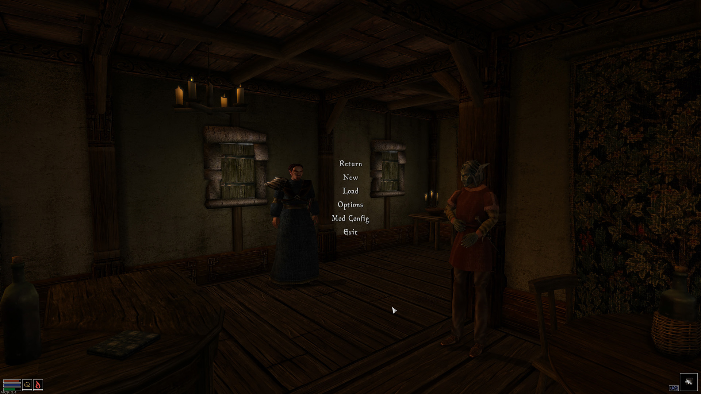

*Silver Edition menu buttons.*

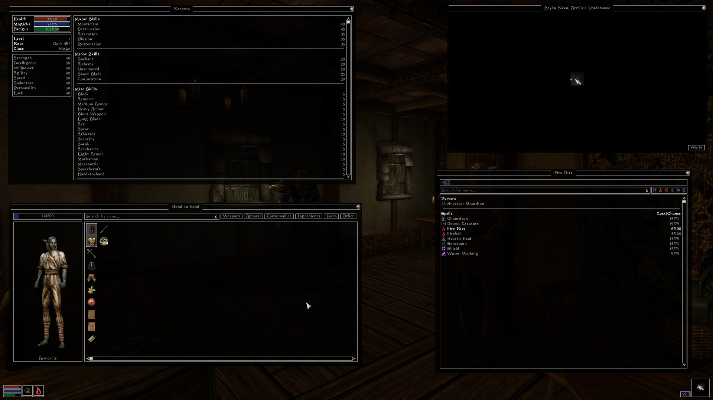

*Silver Edition HUD and UI elements.*

## Uninstallation

If using a Mod Manager, simply disable UI Remastered.

If uninstalling manually, remove all the files added by this mod and restore the original ones from a clean install of Morrowind. It may be easier to reinstall the game.

If uninstalling the Silver Edition, also revert your Morrowind.ini changes to those below.

```ini
[FontColor]
color_normal=202,165,96
color_normal_over=223,201,159
color_normal_pressed=243,237,221

color_active=96,112,202
color_active_over=159,169,223
color_active_pressed=223,226,244

color_disabled=179,168,135
color_disabled_over=223,201,159
color_disabled_pressed=243,237,221

color_link=112,126,207
color_link_over=143,155,218
color_link_pressed=175,184,228

color_journal_link=37,49,112
color_journal_link_over=58,77,175
color_journal_link_pressed=112,126,207

color_journal_topic=0,0,0
color_journal_topic_over=58,77,175
color_journal_topic_pressed=112,126,207

color_answer=150,50,30
color_answer_over=223,201,159
color_answer_pressed=243,237,221

color_header=223,201,159
color_notify=223,201,159

color_big_normal=202,165,96
color_big_normal_over=223,201,159
color_big_normal_pressed=243,237,221

color_big_link=112,126,207
color_big_link_over=143,155,218
color_big_link_pressed=175,184,228

color_big_answer=150,50,30
color_big_answer_over=223,201,159
color_big_answer_pressed=243,237,22

color_big_header=223,201,159
color_big_notify=223,201,159

color_background=0,0,0
color_focus=80,80,80

color_health=200,60,30
color_magic=53,69,159
color_fatigue=0,150,60

color_misc=0,205,205

color_weapon_fill=200,60,30
color_magic_fill=200,60,30

color_positive=223,201,159
color_negative=200,60,30

color_count=223,201,159
```
